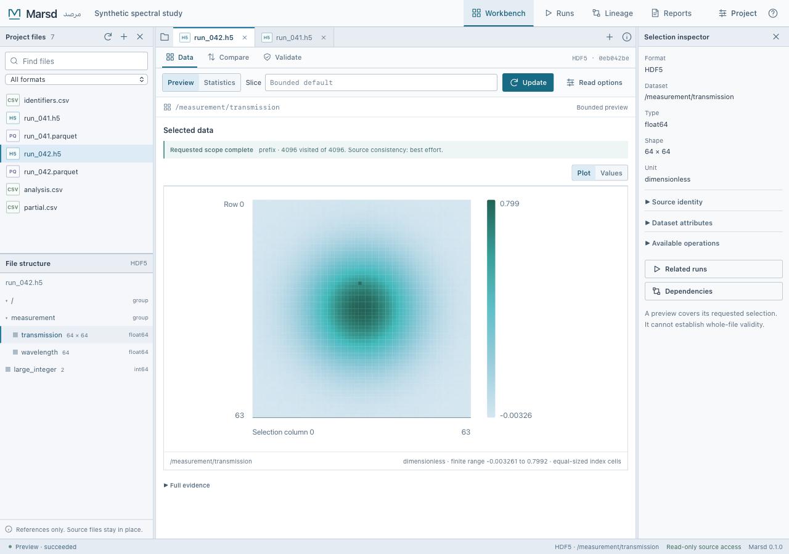

<p align="center">
  
</p>
<h1 align="center">Marsd · مرصد</h1>
<p align="center"><strong>Scientific data. Clear evidence.</strong></p>
<p align="center">A local scientific data workbench for desktop, browser and
terminal.</p>
<p align="center">
  <a href="https://github.com/MohamedElashri/marsd/releases/latest">Download</a> ·
  <a href="#browser-and-cli-with-sample-data">Try the sample</a> ·
  <a href="docs/usage.md">Usage</a> ·
  <a href="CHANGELOG.md">Changelog</a> ·
  <a href="docs/development.md">Contributing</a>
</p>

Marsd is a local workbench for **HDF5, Parquet and CSV** data. Inspect an
output, compare it with an earlier result, and check the fields, values and
units your workflow depends on. Save findings as JSON or standalone HTML
reports for review or handoff.

Use the **desktop app or local browser workbench** for interactive exploration,
the **CLI** for repeatable checks, and the **Python SDK** to record selected
script activity. Your source files stay in their original folders. No account,
telemetry or hosted service is required for ordinary use.



*Inspecting an HDF5 map with its hierarchy, units and scope. Synthetic data.*

## What you can do

- **Explore an unfamiliar file.** Browse HDF5 groups and datasets, inspect table
  schemas, and view numeric slices as plots or values.
- **Compare two outputs.** Align tables by keys or row position, compare array
  slices, and set numeric tolerances or opt into unit conversion.
- **Check a data handoff.** Apply YAML rules for required fields, types, shapes,
  ranges and units. Export findings as JSON or standalone HTML.
- **Review recorded work.** Follow selected Python runs, their inputs and
  outputs, failures and documented dependencies.

Results keep source identity, scope and coverage with the findings, so the
limits of a check remain visible when you review or share it. Inspection is
read-only; recorded Python scripts must be trusted and are not sandboxed.

## How it runs

**One application, three interfaces:** all share the same Python engine,
project format, saved reports and run records. Desktop and browser display the
same graphical workbench.

| Interface | How you use it |
|---|---|
| **Desktop app** | A standalone window. Python is bundled, and Marsd manages its local backend automatically. |
| **Local browser app** | `marsd open PROJECT` serves the workbench on `127.0.0.1` from your Python environment. Keep the terminal running. |
| **CLI and Python SDK** | Run checks directly from the terminal, or add explicit hooks to Python scripts to record selected inputs, outputs and stages. |

Explore a project in the desktop app, close it, run CLI checks, then reopen it
to review saved reports. SDK-recorded runs appear in the workbench too. One
writer owns a project at a time; stop the browser server or close the desktop
project before writing from the CLI.

## Get started

### Desktop

Download the package for your computer from the
[latest release](https://github.com/MohamedElashri/marsd/releases/latest), or
[all releases](https://github.com/MohamedElashri/marsd/releases) for
experimental prereleases:

| Computer | Package | Install |
|---|---|---|
| macOS, Apple Silicon | `.dmg` | Open the disk image and copy Marsd to Applications. |
| Windows, x86_64 | `-setup.exe` | Run the installer, then launch Marsd. |
| Ubuntu Linux, x86_64 | `.deb` | From the download folder, run `sudo apt install ./marsd-*-linux-x86_64.deb`. |

Desktop packages need no separate Python or server setup. Builds are
experimental and unsigned/ad-hoc. Check release notes for compatibility and
signing status, and verify downloads against `SHA256SUMS`.

1. Launch Marsd and choose **Create project…**.
2. Choose a **Project folder** for metadata and reports. If your data is
   elsewhere, expand **Additional source folders** and choose
   **Add source folder** to approve that location. Source files stay in place.
3. Choose **Create project**, then **Add file** to select an HDF5, Parquet or
   CSV file from an approved folder.
4. Open the file in the navigator. For HDF5, select a numeric dataset; use
   **Plot** or **Values** to explore it.

### Browser and CLI with sample data

To try Marsd without your own data, use the synthetic example project. Install
Git and [uv](https://docs.astral.sh/uv/getting-started/installation/), then run:

```sh
git clone https://github.com/MohamedElashri/marsd.git
cd marsd
uv sync --locked
uv run marsd fixtures generate --output ./demo --seed 42
uv run marsd open ./demo
```

Use a new or empty `demo` folder. Node.js and a frontend build are not required.

1. Keep the terminal running. In the browser, enter the one-use launch code
   printed in the terminal. If the browser does not open, use the printed URL.
2. Open `run_042.h5` and select `/measurement/transmission` in the navigator.
   You should see a 64 × 64 heatmap. Switch to **Values** to inspect its
   numbers.

To use the CLI, stop the browser server with Ctrl-C, then inspect the same file:

```sh
uv run marsd inspect ./demo/data/run_042.h5 --project ./demo
```

This prints the file's hierarchy and metadata. You can also open `demo` in the
desktop app through **Open project…** after stopping the browser server.

Next, try
[comparison and validation](docs/usage.md#explore-compare-and-validate)
on the sample's deliberately changed outputs. See [usage](docs/usage.md) for
your own files, SDK recording and recovery, or
[development](docs/development.md) for builds and contributions.

## License

[Apache License 2.0](LICENSE). Distributed dependencies retain their own
licenses and notices.
